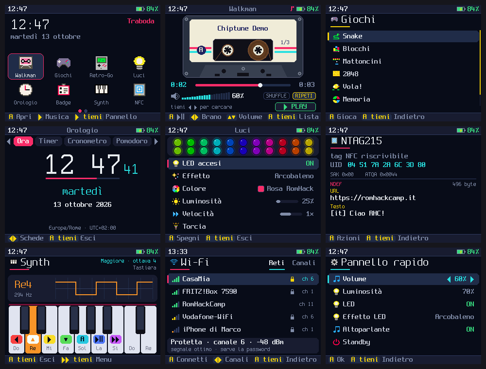

# Traboda OS

A companion and console firmware, written from scratch, for the **RomHack Camp 2026
badge**: the Walkman-shaped ESP32-S3 handheld handed out at
[RomHack Camp](https://badge.romhack.io) (Cyber Saiyan; the PCB carries the
**Traboda** brand on its back, hence the name).

Traboda OS is MicroPython 1.29 with a custom board definition and an OS in Python on
top: a launcher, a Walkman music player, games, an LED studio, an NFC tool, Wi-Fi and
Bluetooth tools, weather, a name-tag mode, a synth, and a dashboard fed by your Mac.
It keeps the badge's stock **Retro-Go** emulators in their own partitions and boots
into them from its launcher, so the badge stays a retro console too.

## The badge

| | |
|---|---|
| SoC | ESP32-S3 (2x Xtensa LX7 240 MHz), 16 MB flash, 8 MB octal PSRAM, Wi-Fi 4, BLE 5 |
| Screen | 2.4" 320x240 TFT (ILI9341) |
| Keys | D-pad, A, B, and Walkman transport keys (rewind, play, fast-forward) |
| Audio | ES8156 DAC: 3.5 mm stereo jack + mono speaker |
| Lights | 22 addressable RGB LEDs |
| Extras | 13.56 MHz NFC reader/writer (Ci522, PCB antenna), microSD, Qwiic/STEMMA QT port, LiPo + USB-C charging |

Pinout, quirks and what was measured on a real badge: [docs/hardware.md](docs/hardware.md).

### How it compares to a PicoCalc

| | RomHack 2026 badge | ClockworkPi PicoCalc (Pico 2 W) |
|---|---|---|
| CPU | ESP32-S3, 2x 240 MHz | RP2350, 2x Cortex-M33 150 MHz |
| RAM / flash | 512 KB + 8 MB PSRAM / 16 MB | 520 KB + 8 MB PSRAM / 4 MB |
| Screen | 2.4" 320x240 | 4" 320x320 IPS |
| Input | 9 keys | 67-key backlit QWERTY |
| Audio | I2S DAC, stereo jack + speaker | dual PWM speakers + jack |
| Radio | Wi-Fi + BLE 5 | Wi-Fi + Bluetooth 5.2 |
| Extras | NFC, 22 RGB LEDs | - |
| Power | built-in LiPo | one 18650 |

They are complementary: the PicoCalc is a pocket computer you program on its own
keyboard; the badge is faster, sounds better, has NFC and LEDs, runs NES/Game Boy
emulators well, but with nine keys and a small screen it is a gadget, a companion and a
console rather than a computer. Traboda OS is built for that.

## Features

| App | |
|---|---|
| Walkman | WAV player with a drawn, spinning cassette; library, shuffle/repeat, seek, LED VU meter. The transport keys control it from anywhere |
| Giochi | Snake, Blocchi (falling blocks), Mattoncini (breakout), 2048, Vola! (flappy), Memoria (Simon with the LEDs), Riflessi; best scores kept |
| Retro-Go | boots the stock emulators (NES, Game Boy/Color, Master System/Game Gear, PC Engine, Lynx, SNES, Doom); exiting Retro-Go comes back here |
| Luci | LED studio: effects, colours, brightness, speed, torch |
| Orologio | big clock, timer with the LED strip as progress, stopwatch, pomodoro |
| Badge | conference name tag with your nickname and a matching LED animation |
| Synth | seven-note instrument on the keys plus an 8-step sequencer on the LEDs |
| NFC | reads ISO 14443-A cards and tags (UID, type, NTAG/Ultralight NDEF, MIFARE Classic default keys), saves dumps, writes URL/text to NTAG stickers. Hold cards over the Cyber Saiyan logo, where the antenna coil is |
| Wi-Fi | scan, connect with an on-screen keyboard, saved networks, channel chart, NTP |
| Bluetooth | BLE scanner with vendors, a Geiger-style finder, and "Badge vicini" to spot other Traboda badges |
| Meteo | Open-Meteo forecast for Italian cities, cached offline |
| Companion | your Mac's CPU, RAM, battery and now-playing, pushed over USB by `tools/companion.py` |
| File | browse the internal memory and the SD card, view, delete, play |
| Impostazioni | screen, audio, LEDs, time zone and manual clock, key test, system info, standby |

Quick panel (hold play) anywhere: volume, brightness, LEDs, speaker, standby.

### Keys

* **A** opens/selects, **B** goes back (holding A also goes back).
* **play** plays/pauses music from any app, **next**/**rewind** skip tracks; **holding
  play** opens the quick panel. Games use play as pause.
* Hold **B** while switching on to skip the OS and stay at the MicroPython REPL.

## Install

Tools: Python 3, [esptool](https://github.com/espressif/esptool) and
[mpremote](https://docs.micropython.org/en/latest/reference/mpremote.html)
(`brew install esptool mpremote` or `pip install esptool mpremote pyserial`).

1. Get the firmware: download `traboda-firmware` from the latest
   [CI run](../../actions) into `firmware/dist/`, or build it (below).
2. Optional but wise: back up the stock firmware first:
   `python3 tools/flash.py --backup stock-badge.bin` (16 MB).
3. Switch the badge on (slide switch), plug it in with a data USB-C cable and run
   `python3 tools/flash.py --erase-fs` (first install; later updates without
   `--erase-fs` keep your settings). Only the bootloader, the partition table, the
   factory app and Traboda's filesystem are written: Retro-Go is untouched.
4. Back to stock at any time: `python3 tools/flash.py --restore stock-badge.bin --yes`.

`tools/badge.py` finds the badge by its USB vendor id, so other boards on the bus (a
Pico, say) are never touched. If the badge does not show up, hold BOOT (on the back),
tap RESET, release BOOT, and flash again.

### Build

ESP-IDF v5.5.2 (`git clone -b v5.5.2 --recursive https://github.com/espressif/esp-idf
~/esp/esp-idf && ~/esp/esp-idf/install.sh esp32s3`), then `./firmware/build.sh`. It fetches
MicroPython 1.29.0, applies `firmware/patches/`, freezes `src/traboda` into the image and
writes `firmware/dist/{bootloader,partition-table,traboda}.bin`. CI does the same in the
`espressif/idf:v5.5.2` container.

## Music, Wi-Fi, Mac companion

* **Music**: 16-bit PCM WAV files in a `music` folder on the SD card, or in the internal
  memory (about 4 MB free). `python3 tools/music.py song.mp3 ...` converts with ffmpeg
  and uploads; two original chiptunes (`tools/chiptune.py`) ship as demos.
* **Wi-Fi**: Wi-Fi app, pick a network, type the password on the on-screen keyboard. It
  is saved on the badge only (`/settings.json`), never in this repository.
* **Companion**: with the badge on USB, `python3 tools/companion.py` and open the
  Companion app. `--notify "text"` pops a notification on the badge.

## Development

* `docs/DEVELOPING.md`: the app contract and every API.
* `sim/`: the whole OS runs headless on the MicroPython unix port; `sim/run.py` drives
  it with scripted key presses and `sim/topng.py` turns snapshots into PNGs.
* `python3 tests/smoke.py`: compiles every module for the badge and walks every app in
  the simulator.
* `tools/dev.py sync` pushes `src/traboda` (as .mpy) onto a running badge, shadowing the
  frozen copy; `tools/dev.py snap shot.png` takes a screenshot of the real screen over
  USB, `tools/dev.py key right` presses a key.

## Credits

Badge hardware and stock firmware by [Cyber Saiyan](https://www.cybersaiyan.it)
([rhc2026-badge](https://github.com/cybersaiyanIT/rhc2026-badge)). Fonts: Spleen by
Frederic Cambus. Built on MicroPython and ESP-IDF; see [THIRD_PARTY.md](THIRD_PARTY.md).
Traboda OS is MIT licensed.
